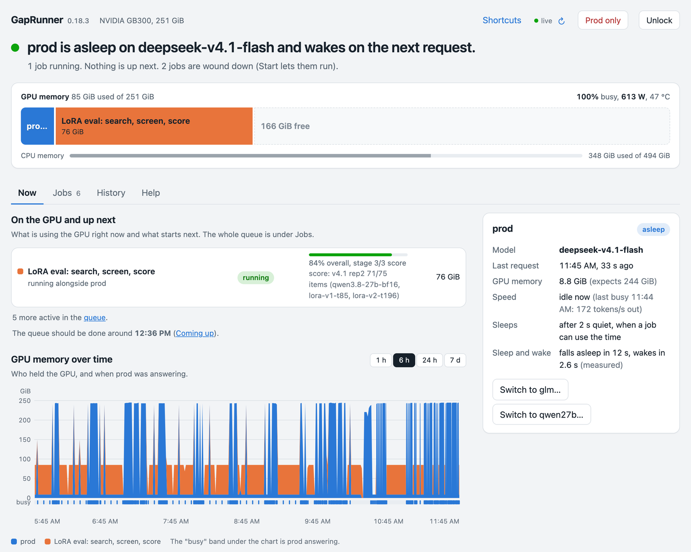

# GapRunner

**A job queue for the GPU that runs your local model. Line up training, evals and benchmarks; GapRunner runs them in
order, beside the model when they fit and in its idle gaps when they don't, and gives the GPU back the moment a
request arrives.**



A machine like a DGX Station runs a model server all day and has a list of other GPU work waiting: fine-tunes, evals,
benchmark sweeps. Something has to decide what runs next, keep jobs from fighting over memory, notice when one
stalls, and get it out of the way when the model needs the GPU. GapRunner does that, in two parts:

- **Job and queue management.** Jobs go into a queue with an order, limits and dependencies, and GapRunner runs them
  when there is room for them. You see what's running, how far along it is, when the queue should be done, and why a
  job is waiting. This matters even when the model is rarely idle: with many agents calling it all day, the queue
  still decides what gets the rest of the GPU, and in what order.
- **The model's idle gaps.** Between requests the model is often idle. GapRunner puts it to sleep and lets queued jobs
  use the GPU. When a request comes in, the jobs step aside (they sleep, freeze or stop), the model wakes, and the
  request is answered as usual.

It is one Python package (standard library only, Apache-2.0) that runs beside your model server on a single NVIDIA
GPU. It is early (0.x) and has been running in production on one NVIDIA DGX Station GB300 since October 2026.

## Job and queue management

| | |
|---|---|
| **Queue** | Order jobs by dragging them on the page or through the API. `after` chains run B once A has finished; holds keep a job waiting until you start it; a starvation guard moves a job that has waited too long to the front. |
| **Max active jobs** | At most N jobs on the GPU at once (`max_active_jobs`); the rest wait in queue order. A job higher in the queue pushes the lowest active one aside, unless that job would lose work by stepping aside. |
| **Controls** | Start, Wind down (stop at the job's next saved point), Stop, Pause and Clear, on one job or many at once. |
| **Progress and timing** | Each job reports its progress (`progress_cmd`). GapRunner estimates the GPU-hours left, when the queue should be done, and shows what's coming up next. |
| **Health** | Stalled jobs and failing health checks are flagged, with alerts through `notify_cmd` (a phone push, a webhook). `max_hours` caps how long a job may run before it is held. |
| **Memory** | Each recipe states its GPU, CPU and disk use, measured for you by `gaprunner calibrate`. A job starts only when the driver shows room for it, keeping a GPU reserve and a host-memory floor. |
| **Saved work** | A job that loses unsaved work when stopped gets only quiet spells long enough to reach its next saved point, and every lost stretch is recorded. |
| **Work you run by hand** | Claims: a process you started yourself is counted in memory, or holds the queue while it runs. |
| **Jobs API** | Other programs put jobs into the queue from templates you write: a caller fills in typed, checked parameters, never a command. Each program has its own token, limited to some templates, a GPU memory cap and a number of open jobs ([JOBS-API.md](docs/JOBS-API.md)). |
| **Apps that ask first** | An app that starts its own GPU server when someone asks for work can ask GapRunner for a reservation and wait in the queue in its place (`driver = "governor"`). Imagination Studio's renderer speaks this protocol. Each piece of work it runs is recorded with its size, time and memory. |
| **Recipes** | A job is a TOML entry: how to start it, its goal, progress, saved-point, summary and health commands, its memory per tier, a colour. |
| **For agents** | An [agent guide](docs/AGENT-GUIDE.md), a drop-in [skill](skills/gaprunner/SKILL.md) and [llms.txt](llms.txt), so coding agents can read state, queue jobs and explain why a job is waiting. |

## Sharing the GPU with the model

| | |
|---|---|
| **Placements** | Each job says where it may run: beside the model (`share`), beside it but pausing its compute while the model answers (`yield`), only while the model sleeps (`no`), or only in slow-wake / no-model periods (`window_only`). |
| **Engines** | Several engines behind one service name, switched by hand, from the page or on a daily schedule. The gate rewrites the request's model name, so clients keep one alias. `warm_cmd` brings an engine back to full speed after a wake. |
| **Periods for big jobs** | "Slow-wake" periods let slower jobs run while the model sleeps (requests may wait longer); "No prod" periods stop the model so a big job gets the whole GPU, then start it again. |
| **Web page** | One self-contained HTML file (no CDN, no build step) with live updates. See below. |

## One night on a GB300 Station

Over **7.3 hours and 1,214 requests** to the model:

| | |
|---|---:|
| Time the model spent asleep, giving the GPU to jobs | **51%** |
| GPU time the background eval job got | **3.7 GPU-hours** |
| Requests that waited nothing extra | **85%** |
| Added wait, averaged over all requests | **1.3 s** |

- **The model:** DeepSeek V4.1 Flash on vLLM with sleep mode. It falls asleep in about 10–12 s and wakes in about
  2.5 s. It is back to full speed about 20 s after a wake, once its `warm_cmd` has read its lookup tables back into
  memory; requests are answered during that time.
- **The job:** a Qwen 27B BF16 evaluation with LoRA adapters. It steps aside in about 1–3 s and comes back in about
  1.5–2 s: its park hook puts its own vLLM server to sleep and freezes what is left with cuda-checkpoint, leaving 0 GiB
  on the GPU.

That's one machine and one workload. Yours will look different.

## How it works

```
clients ──> gate (one per model service) ──> your model server (vLLM, SGLang, ...)
               │ sees every request, holds it while the model wakes
               v
            runner ── every second ──> scheduler: who should hold the GPU now?
               ├── drivers: put services to sleep and wake them; park and resume jobs
               └── nvidia-smi: what is really on the GPU, per process
```

1. **The gate** is a small proxy in front of each model service. Clients send requests to it instead of to the
   server. It sees every request, wakes the model if it is asleep, holds the request until the model is ready, and
   streams the answer back. Health probes (`/health`, `/v1/models`, `/metrics`, ...) pass straight through and never
   wake it.
2. **The scheduler** decides, once a second, who should hold the GPU. It takes jobs in queue order, within the
   max-active limit and the memory the driver shows free. For jobs that need the model asleep, it learns how long your
   service's quiet spells last and measures how long each job takes to step aside and come back, then starts work
   when a gap is worth the swap. An idle model is put to sleep only when a waiting job can use the time; otherwise its next request costs
   nothing.
3. **Drivers** do the stepping aside: vLLM or SGLang sleep mode for model servers, cuda-checkpoint to freeze a CUDA
   process in place, a restart from the job's own checkpoint, or your own shell hooks.

The scheduler is a pure function of a snapshot, so the daemon and `gaprunner replay` run identical rules. See the
[design](docs/DESIGN.md).

### Drivers

| Driver | How it steps aside and comes back |
|---|---|
| `vllm` | Sleep and wake through vLLM's API. |
| `sglang` | Release and resume memory occupation (experimental). |
| `cuda-checkpoint` | Move a CUDA process's GPU state to host memory, then restore it. |
| `restart` | Stop the job, then run `start_cmd` again; the job resumes from its own checkpoint. |
| `command` | Your own park, resume and state hooks. |
| `park-protocol` | Berth's park protocol, in both directions: GapRunner parks anything that implements it, and `gaprunner adapter` lets Berth park GapRunner's jobs. |

### The web page

- **Now:** GPU memory by holder, memory over time (1 h to 7 d) with the model's busy periods marked, and a card per
  model service with its state, measured sleep and wake times, and engine stats (tokens/s, time to first token, KV
  cache use, prefix-cache hits).
- **Jobs:** the queue as a table with search, tags, drag to reorder and bulk actions; a details pane with the job's
  log, recipe, run history and its own best results so far (from `summary_cmd`); a timeline of what is coming up.
- **History** and **Help** tabs. Every job and service says in a sentence why it is (or isn't) running.
- Engine switching, "Slow-wake" periods (slower jobs may run while the model sleeps; requests may wait longer) and
  "No prod" periods (the model is stopped so a big job gets the whole GPU, then started again).
- Claims for work you started by hand, so its memory is counted or scheduling holds while it runs; GPU memory nobody
  claims is shown as unknown, and model servers GapRunner doesn't manage are named where it can find them.
- Reading needs nothing; every change needs a PIN.

## Keeping the model first

- **A deadline on request wakes.** When a request needs the GPU, jobs get `wake_deadline_s` to step aside (at least
  twice a job's own measured step-aside time); a stuck job is stopped hard and the wake goes ahead.
- **Memory counts as free only when nvidia-smi shows it free.** GPU processes that belong to nothing configured are
  reported and left alone.
- **Prod only:** a kill switch (the button on the page, or `gaprunner pause` / `unpause`): every job steps aside, the
  services stay awake and nothing new starts.
- **Wind down:** a job with a `saved_cmd` stops at its next saved point; without one, it finishes its current run.
- **Health checks** flag stalled jobs and services that stop answering, and send alerts anywhere through
  `notify_cmd` (a phone push, a webhook).
- **A watchdog** (`gaprunner watchdog`) runs your `bypass_cmd` to send clients straight to the model server if the
  gate stops answering.
- **Shadow mode** watches, learns your quiet spells and logs what it would do, without acting. **`replay`** runs a
  real request log through the same rules, so you can preview a policy before it touches the GPU.
- Every transition goes to `audit.jsonl` with its measured time.

## Try it (shadow mode first)

You need **Linux, Python 3.11+ and an NVIDIA GPU** with `nvidia-smi` working, and a model server that can sleep
(macOS runs the test suite only). GapRunner is **not on PyPI yet**; install it from GitHub:

```bash
python3 -m venv .venv && source .venv/bin/activate
pip install git+https://github.com/benbuschmann/gaprunner
gaprunner example > gaprunner.toml        # one vLLM service, no jobs, shadow mode: edit its upstream and memory
```

Start your model server with sleep mode, for vLLM:

```bash
VLLM_SERVER_DEV_MODE=1 vllm serve <model> --enable-sleep-mode --port 8000
```

Check the config (it reads the GPU and every server once and writes nothing), then run:

```bash
gaprunner check gaprunner.toml --strict
gaprunner run gaprunner.toml
```

With the example addresses:

1. Point clients at the gate, `http://127.0.0.1:8100` (OpenAI-compatible clients: base URL
   `http://127.0.0.1:8100/v1`), or point a router such as llama-swap at it.
2. Open the page at `http://127.0.0.1:8096`. It is read-only until you create the PIN file named by `ui_pin_file`
   (`mkdir -p ~/.config/gaprunner && (umask 077; echo 'pick-a-pin' > ~/.config/gaprunner/pin)`).
3. Let shadow mode watch real traffic for a while, then replay it to see what GapRunner would do:
   `gaprunner replay gaprunner.toml ~/.local/state/gaprunner/activity.jsonl`. When it looks right, set
   `mode = "live"` and restart.
4. Add jobs with `hold = true`, measure them with `gaprunner calibrate`, and start them from the page.
   [docs/RECIPES.md](docs/RECIPES.md) walks through it; [examples/gb300-workstation.toml](examples/gb300-workstation.toml)
   is a fuller config with a benchmark and a LoRA run.

To run it under systemd, start from [examples/gaprunner.service](examples/gaprunner.service) and keep
`KillMode=process`, so restarting or upgrading GapRunner leaves running jobs alone. While the gate is in your clients'
request path, also run `gaprunner watchdog` with a `bypass_cmd`
([CONFIG.md](docs/CONFIG.md#when-the-gate-stops-answering)).

## What it doesn't do

- **One GPU per instance.** It manages one GPU (by default the one with the most memory). More than one GPU is on the
  [roadmap](docs/DESIGN.md#roadmap).
- **Not a cluster scheduler.** It shares one box between a model server and background jobs; it doesn't place work
  across machines.
- **The gate is in the request path.** If GapRunner stops, requests stop unless the watchdog routes around it, and a
  bypass doesn't wake a sleeping server by itself.
- **The config is trusted.** Recipes, hooks and `notify_cmd` run as shell commands with GapRunner's permissions.
- **Jobs must be able to step aside**: resume from their own checkpoint, be freezable by cuda-checkpoint, or sleep
  like a model server. GapRunner doesn't make arbitrary code resumable, and a `share` job can slow inference.

## Docs

- [Job recipes](docs/RECIPES.md): placements, drivers, lifecycle, calibration, with examples
- [Config reference](docs/CONFIG.md): every field and its default
- [Agent guide](docs/AGENT-GUIDE.md): for AI agents on a GapRunner machine; plus the [skill](skills/gaprunner/SKILL.md) and [llms.txt](llms.txt)
- [Design](docs/DESIGN.md): the pieces, the decisions and the roadmap
- [Prior art](docs/PRIOR-ART.md) · [Changelog](CHANGELOG.md) · [Contributing](CONTRIBUTING.md) · [AGENTS.md](AGENTS.md) for code changes

The tests use a fake GPU and a fake vLLM server, so they run anywhere: `python3 -m unittest discover -s tests`.

## Prior art

Model-swapping brokers already exist and are good: [Berth](https://github.com/T-Crypt/berth),
[llama-swap](https://github.com/mostlygeek/llama-swap), [gpu-broker](https://github.com/emergenthq-net/gpu-broker),
[llmux](https://github.com/doublewordai/llmux) and [gpuq](https://github.com/elektricM/gpuq) take turns between
*services*. Research systems (LLMStation, SIRIUS, ConServe, DeltaServe, PipeSwitch) share a GPU between serving and
training inside one engine. GapRunner fills a model's idle gaps with arbitrary resumable jobs, and borrows openly
from these projects. Credits in [docs/PRIOR-ART.md](docs/PRIOR-ART.md).

## Security

Run GapRunner on a machine you control, on loopback or a private network. Read [SECURITY.md](SECURITY.md) before
exposing anything. In short: the config is code; the PIN guards changes only,
and anyone who can reach the page or the gate can read status and job logs; the gate passes any path through to your
model server.

## License

Apache-2.0. `cuda-checkpoint` (NVIDIA EULA) and CRIU (GPL) are called as external programs and are not included.
