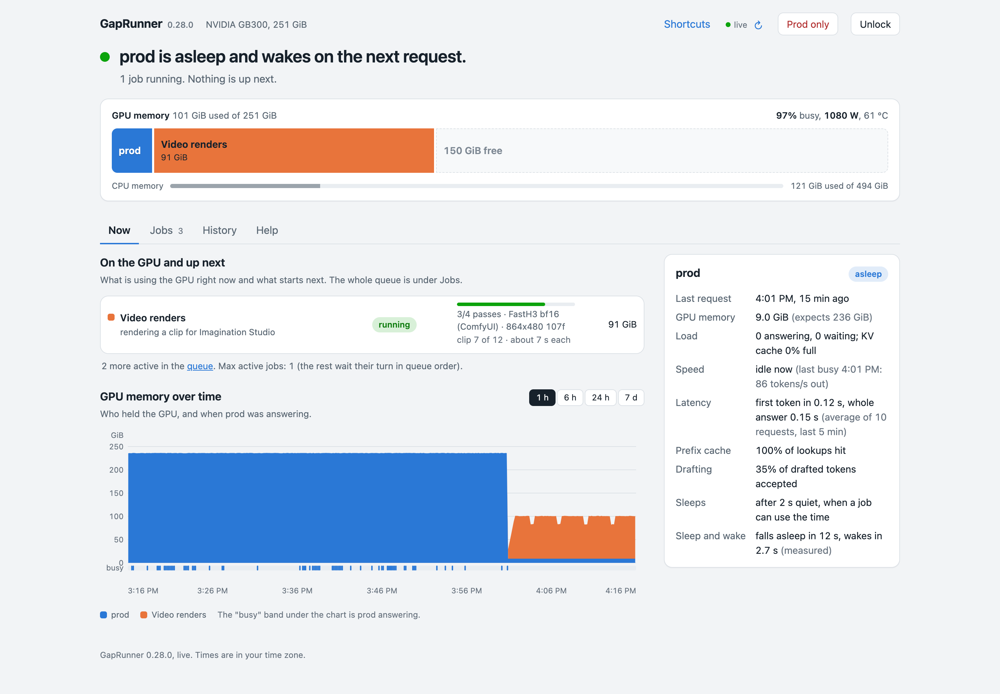

# Imagination Studio renders on a DGX Station

[Imagination Studio](https://github.com/drowzeys/Imagination-Studio-by-keys-Wasserman) (by Keys and Sam Wasserman, powered
by TensorFold) is a local AI film studio. You plan and write on one machine, and it can send clips to other machines
to render. This page is how we run a DGX Station as one of those machines while it also serves an LLM all day and
trains in the gaps, with GapRunner deciding when the renderer gets the GPU.



## What happens when someone presses Render

1. The studio (on a DGX Spark, in our case) picks a machine for the clip. The Station is in its list of Sparks.
2. On the Station, the studio's renderer is about to start ComfyUI. Before it does, it asks GapRunner for a
   reservation through the workload-governor protocol the studio already has (`SPARK_GOVERNOR`).
3. GapRunner treats the request as a job at the top of its queue. It puts the model to sleep if it is idle (or
   waits for the current requests to finish), parks the training run at its last saved step, and grants the
   reservation. The first time we tried it, the grant took 4.1 s with a 9B training run moved aside; with nothing
   to move it takes under a second.
4. ComfyUI starts inside the reservation and renders. GapRunner reads ComfyUI's `/queue`, so it knows a render is
   running, and records each one.
5. The studio sends more clips; they render one after another under the same reservation.
6. After 10 minutes with nothing to render (`idle_release_s = 600`), GapRunner revokes the reservation. The renderer
   stops, the training run comes back, and the model wakes on its next request.

If GapRunner can't admit a render any time soon (the job is wound down, or set to run only in No-prod periods and none
is open), it turns the request down at once and the studio renders the clip somewhere else.

## Setting it up

**On the Station.** Install Imagination Studio's worker side as its own user, with no sudo and no Docker group. That
user only needs to read GapRunner's governor folder. You don't start the studio app there: the head starts the
renderer over SSH when it sends a clip. Put these in that user's environment (for example at the top of `~/.bashrc`,
since the head runs commands over a non-interactive SSH login):

```sh
export STUDIO_GPU=1                                 # which GPU index to use, if the machine has more than one
export SPARK_GOVERNOR=/var/tmp/gaprunner-governor   # GapRunner's governor_dir
export SPARK_MEMORY_FLOOR_MB=20480                  # the studio's own host-memory floor
```

**In GapRunner.** Add a `driver = "governor"` job. The full recipe, with every option, is in
[RECIPES.md](RECIPES.md#apps-that-ask-before-they-start-driver--governor). The parts that matter here:

```toml
[gaprunner]
governor_dir = "/var/tmp/gaprunner-governor"
governor_uids = [1006]                       # the studio user's uid

[[job]]
name = "Video renders"
driver = "governor"
owner = "tensorfold-studio-comfy-8190"       # the name the studio's renderer asks under
order = 0                                    # renders first, training waits
gpu_gib = 95                                 # FastH3 at 864x480 peaked at 92 GiB on the first, cold clip
cpu_gib = 90
coexist = "no"                               # only while the model sleeps
comfy_url = "http://127.0.0.1:8190"
idle_release_s = 600
```

**In the studio.** Add the Station to the Sparks list on the head, with the SSH address of the studio user, and use
"Update and start" once: it copies the head's code to the worker and checks the models.

**Optional: skip the Station when it can't render.** [examples/studio_worker_sync.py](../examples/studio_worker_sync.py)
reads `admits_now` from GapRunner's `/api/status` and ticks or unticks the Station in the studio's list, so the head
doesn't send a clip that would only be turned down.

## What you see

On GapRunner's page the job is **idle** until the studio asks, **waiting** while GapRunner makes room, and
**running** while the reservation is held. Its memory shows in the GPU bar beside the sleeping model.

The live counter in the screenshot ("3/4 passes · FastH3 bf16 (ComfyUI) · 864x480 107f") comes from a two-line
progress file the renderer writes (`SPARK_PROGRESS_FILE`), which the job's `progress_cmd` reads every 2 s. That file
is [proposed upstream](https://github.com/drowzeys/Imagination-Studio-by-keys-Wasserman/pulls?q=SPARK_PROGRESS_FILE)
and not in Imagination Studio yet. Without it the job still shows as running, without the pass count. With it, set
`progress_cmd = "cat /var/tmp/wass-progress.txt 2>/dev/null"` and `progress_every_s = 2` on the job, and
`export SPARK_PROGRESS_FILE=/var/tmp/wass-progress.txt` for the studio user.

Each render adds a row to `<state_dir>/governor-<job>.jsonl`: width, height, frames, passes, the model files
it loaded, how long it took, and the GPU and host memory at the peak. A `ready` row records how long ComfyUI took
from the grant to its first answer.

## Numbers from one GB300 Station

A 864x480 clip of 107 frames with sound, FastH3 with 4 passes, warm:

| Setup | Time per clip |
|---|---:|
| `SPARK_ENGINE=comfy` (ComfyUI's bf16 blocks) and `SPARK_COMFY_ARGS=--use-pytorch-cross-attention` | about 12.3 s |
| the same, plus the fp16 video decoder (`SPARK_VAE=minimax_h3_video_vae_fp16.safetensors`) | **about 6.8 s** |

The studio's default TensorFold int8 blocks are tuned for the DGX Spark (GB10). On the GB300 they took 23 s for a
clip half that length (56 frames). In our setup int8 matrix maths was the slow part: we measured 156 TOPS for int8
against 1,893 TFLOPS for bf16 and 4,111 for fp8. The per-render rows are how we found the second step. The sampler took
3.8 s of a 12.3 s clip, and decoding the video took 6.7 s. With the fp16 decoder that part takes 1.3 s.

A cold first clip (models loading from disk) took 2 to 2.5 minutes. The Spark keeps its int8 setup, which is the
faster one there.

Measured with GapRunner 0.28 and Imagination Studio 4.1 in October 2026. On 2026-10-30 we moved both machines to
stock Imagination Studio 4.3.1: its governor hook (`spark/workload.py`) is unchanged since 4.1, and a 4.3.1 worker
passes GapRunner's preflight. The timings above were not re-measured on 4.3.1.
